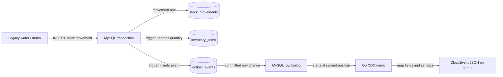

# Go Legacy CDC Lab

**This lab shows how to move inventory changes out of a legacy MySQL system without making its writer publish directly to a broker.** A MySQL trigger records each stock movement and its outbox event in the same transaction; a small Go process reads the new row from the binlog and prints it as a CloudEvent.

The example is synthetic and independently written. It contains no customer code, data, schema, or credentials.

## Run the demo

Requirements: Go 1.23+ and Docker Compose.

```bash
make up && make demo
```

The command starts MySQL 8.4, inserts one movement for `DEMO-001`, reads the resulting outbox insert from the row binlog, and prints one CloudEvent JSON object. Each run reduces the seeded quantity by one. IDs vary. The database is exposed only on `127.0.0.1:3307` and uses demo-only credentials. `make down` stops the container and removes its volume, resetting the local database.

Run the test suite with:

```bash
make test
```

The integration test checks that an invalid movement rolls back the movement, balance change, and outbox insert. With the local MySQL container running, run it explicitly using `INTEGRATION=1 go test ./...`. The normal `make test` does not require Docker.

## Architecture



The trigger runs as part of the insert transaction. If the nonnegative-inventory constraint rejects the balance update, MySQL rolls back the movement and outbox insert as well. The Go demo reads only the new outbox row created after it records the current binlog position.

## Design decisions and trade-offs

- **Transactional outbox:** The trigger keeps the synthetic legacy writer simple and commits the movement, balance update, and event together. It adds a write and trigger work to the source transaction, and production use would require the source team's review.
- **Binlog capture:** The Go process reads row changes rather than repeatedly polling the outbox. This avoids polling queries in this demo, while adding replication privileges and binlog retention as operational dependencies.
- **CloudEvents mapping:** `internal/cdc` validates the row shape and JSON payload, then maps the event ID, type, aggregate, payload, and sequence into a CloudEvent. A malformed payload returns an error.
- **Consistency boundary:** The database transaction is atomic. The demo starts at the current binlog position and exits after printing the first new event; it does not persist a GTID checkpoint or provide durable delivery.
- **Duplicates and idempotency:** Event IDs are present, but there is no broker, retry loop, consumer, or idempotent projection. The code does not claim at-least-once end-to-end delivery or exactly-once effects.
- **Concurrency:** This is a one-shot local demonstration, not a throughput-oriented service. It has no parallel processing, ordering policy, bounded queue, or backpressure implementation.

## What this demonstrates

For a backend engineer working across PHP/Symfony and Go, this small project makes a concrete systems-integration problem reviewable: preserve a legacy write path, define the transaction boundary, capture committed changes, validate an event contract, and state reliability limits plainly. The Go code and tests are inspectable evidence; the repository makes no claim that this exact implementation ran in a customer system.

## Scope and next steps

Implemented today: synthetic MySQL schema and trigger, row-binlog reader, CloudEvents conversion, runnable demo, unit tests, and a MySQL integration test for rollback.

Not implemented: durable restart/checkpointing, broker publishing or confirms, retries, idempotent projection, replay handling, observability, load tests, or production hardening. These are described as future work in the [specification](docs/spec.md), [implementation plan](docs/plan.md), [task list](docs/tasks.md), and [ADR 0001](docs/adr/0001-binlog-outbox.md). No throughput, latency, or availability measurements are claimed.

## Further reading

This lab connects to Raúl Almeida's writing on [the polling tax](https://raulalmeidablog.substack.com/p/the-polling-tax-how-to-decouple-legacy), [the Go streamer](https://raulalmeidablog.substack.com/p/building-the-go-streamer-reading), [CloudEvents](https://raulalmeidablog.substack.com/p/from-binlog-to-cloudevents-building), and [idempotent consumers](https://raulalmeidablog.substack.com/p/idempotent-consumers-anti-corruption). The articles discuss broader patterns; this repository implements only the slice described above.

## Interview prompts

1. What duplicate window appears if a future broker publish succeeds but checkpoint persistence fails?
2. What recovery policy would you choose if MySQL purges a binlog before the CDC process resumes?
3. How would you preserve per-SKU ordering while increasing throughput?
4. When is an outbox trigger a reasonable fit for a legacy writer, and when is its source-side cost too high?
5. What measurements would you collect before choosing binlog CDC over polling?
